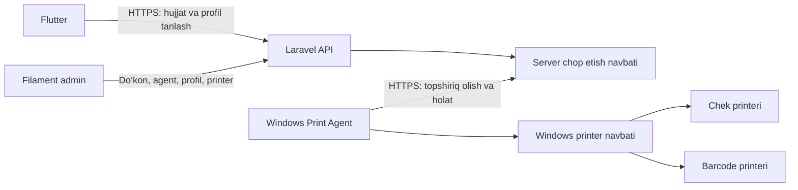

# OsonPOS Print Agent — texnik topshiriq

- Versiya: 1.0
- Sana: 2026-10-24

Holat: foydalanuvchi bilan asosiy talablar aniqlashtirilgan; implementatsiya boshlanmagan.

## 1. Maqsad

Flutter ilovasidan savdo cheklari va mahsulot barcode etiketkalarini do‘kondagi Windows kompyuteriga ulangan printerlarda chiqarish. Kassir telefonda hujjat, o‘lcham va nusxalar sonini tanlaydi. Qaysi hujjat va qog‘oz qaysi printerdan chiqishini admin oldindan belgilaydi. Kompyuterda har bir topshiriq uchun print dialogi yoki PDF dasturi ochilmaydi.

Yechim uch qismdan iborat:

1. Laravel/Filament: admin sozlamalari, ruxsatlar, hujjat tayyorlash, chop etish navbati va audit.
2. Windows Print Agent: printerlarni aniqlash, topshiriqlarni olish, Windows printer navbatiga uzatish va holat yuborish.
3. Flutter: chek/barcode tanlash, o‘lcham va nusxalar, preview, chop etish va natija holati.

## 2. Foydalanuvchi tasdiqlagan qarorlar

| ID | Qaror |
| --- | --- |
| D-01 | Har bir do‘konga bitta faol asosiy kompyuter biriktiriladi. |
| D-02 | V1 internet orqali ishlaydi. Telefon va kompyuter bir Wi-Fi tarmog‘ida bo‘lishi shart emas; ikkalasida ham serverga internet aloqasi bo‘lishi kerak. |
| D-03 | Printerlar, ruxsat etilgan qog‘oz/etiketka o‘lchamlari va standart o‘lchamni admin saqlaydi. Kassir Flutterda ruxsat etilgan o‘lcham va nusxalar sonini tanlaydi. |
| D-04 | Sotuvdan keyingi avtomatik chekni admin yoqadi/o‘chiradi. Qo‘lda chop etish ham mavjud. |
| D-05 | Boshlang‘ich chek profillari: 58 va 80 mm; barcode: 30×20 va 57×30 mm. Admin qo‘shimcha o‘lchamlarni millimetrda qo‘sha oladi. Profil faqat mos printerga biriktiriladi. |
| D-06 | Hali printerga yuborilmagan topshiriq ko‘pi bilan 10 daqiqa avtomatik kutiladi. Keyin chiqarish uchun kassirning yangi tasdig‘i kerak. |
| D-07 | Chiqqan-chiqmagani noma’lum topshiriq avtomatik qayta chiqarilmaydi; darhol tekshirish va ongli qayta chop etish talab qilinadi. |
| D-08 | Printerning Windowsdagi nomi kodga yozib qo‘yilmaydi. Admin ro‘yxatdan tanlaydi; nom o‘zgarsa sozlamadan qayta biriktiradi. |
| D-09 | Bir dastur chek va etiketka printerlarini boshqaradi. Asosiy yangi apparat — foydalanuvchi XP365 deb atagan printer; aniq model/komplektatsiya ulanganda qayd etiladi. |
| D-10 | Sinov uchun production bazasi va prodga ulangan Flutter ilovasida savdo/qarz/qoldiq yozuvlari yaratilmaydi. |

Quyidagi texnik standartlar ushbu TZ taklifidir; ular foydalanuvchi alohida aytgan talab sifatida ko‘rsatilmaydi. Ularni o‘zgartirish zarur bo‘lsa, implementatsiyada ushbu hujjatdagi tegishli qaror va qabul mezoni ham yangilanadi.

## 3. V1 chegarasi

Majburiy natijalar:

- Windows 11 x64 uchun o‘rnatiladigan agent; Windows foydalanuvchisi tizimga kirganda avtomatik ishga tushish.
- Windowsga drayveri o‘rnatilgan, sinovdan o‘tgan chek/etiketka printerlari bilan ishlash. Dastlab kompyuterga USB orqali ulangan printerlar tekshiriladi.
- Flutter Android va iOS klientlari bir xil server API orqali topshiriq yuborishi; Windows agent telefondan mustaqil.
- Alohida chek/barcode printerlari, bir nechta qog‘oz profillari va profilga qarab yo‘naltirish.
- Mahsulot tafsilotidan bitta barcode va mahsulotlar ro‘yxatidan ko‘p mahsulot uchun barcode chiqarish.
- Yangi saqlangan hamda oldin saqlangan savdo chekini chiqarish; qayta chop etishni audit qilish.
- Flutterdagi barcha yangi ekran/dialoglarda light/dark tema va kichik ekran/klaviaturaga moslik.

Keyingi bosqichlar: telefondan bevosita Bluetooth/USB printerga ulanish, internetsiz LAN yo‘li, bir do‘kondagi bir nechta faol kassa kompyuteri, macOS/Linux agenti, agentni Windows loginidan oldin service sifatida ishlatish. Mavjud web print jarayonini yangi agentga o‘tkazish alohida kengaytma; webdagi amaldagi PDF/print oqimi saqlanadi.

Bu modul mavjud savdo chekining chop etish imkoniyatidir. Fiskal operator/terminalga yangi integratsiya kiritilishi ushbu TZ tarkibiga kirmaydi; odatiy chekni fiskal tasdiqlangan deb belgilash mumkin emas.

## 4. Mavjud loyihaga moslashish

| Mavjud qism | Holat va foydalanish |
| --- | --- |
| `routes/web.php` | Bitta mahsulot va ko‘p mahsulot uchun barcode PDF yo‘llari mavjud. Flutter ularni ochiq URL yoki web session orqali ishlatmaydi; autentifikatsiyalangan API qo‘shiladi. |
| `resources/views/product-barcode.blade.php` | Mahsulot nomi, EAN13 barcode, uning raqami va sozlamaga qarab narx. 30×20, 57×30, 85×65 presetlari bor. |
| `app/Filament/Resources/Products/Tables/ProductsTable.php` | Webdagi tanlash oynasida 30×20 va 57×30 mavjud; ko‘p mahsulot tanlash bor. |
| `GeneralSetting.barcode_show_price` | Amaldagi web narx sozlamasi. Yangi barcode profilini yaratishda boshlang‘ich qiymat sifatida olinadi; yangi profil uchun admin alohida saqlaydi, eski web xatti-harakati o‘zgarmaydi. |
| `app/Support/ReceiptData.php`, `resources/views/receipts/partials/default.blade.php` | Server chekining semantik ma’lumotlari va mavjud ko‘rinishi. Jami, chegirma va to‘lov ma’nolari bilan parity saqlanadi. |
| Flutter `pos_screen.dart`, `receipts_screen.dart` | Lokal savdo va chek ko‘rish/nusxa olish bor; fizik printer integratsiyasi yo‘q. |
| Flutter offline sale/outbox | Sotuv va sinxronlash alohida jarayon. Chop etish shu jarayonni qayta ishga tushirmaydi va uning ma’lumotlarini yo‘qotmaydi. |
| `FLUTTER_MOBILE_PLAN.md`, §11.3 | Printer bo‘yicha oldingi talablar kontekst sifatida olinadi. V1ning internet va PC-agent chegarasini ushbu hujjatdagi yangi foydalanuvchi qarorlari belgilaydi. |

Joriy dastur hali universal printer yoki jim chop etish tayyor deb hisoblanmaydi. Hujjatdagi reja bandlari bajarilgan kod/test dalili bilan yopiladi.

## 5. Arxitektura



- Agent serverga tashqariga HTTPS ulanishini o‘zi ochadi. Kompyuterga public IP, ochiq kiruvchi port yoki modemda port forwarding talab qilinmaydi.
- Agent Laravel biznes bazasiga bevosita ulanmaydi; Flutter ham agentning maxfiy kalitini olmaydi.
- Server job, hujjat snapshoti, profil versiyasi va printer yo‘nalishini saqlaydi. Agent faqat o‘ziga biriktirilgan do‘kon topshiriqlarini oladi.
- Polling/long polling bilan ishlaydigan HTTP API V1 uchun yetarli. Job navbati va uning holati ma’lumotlar bazasida saqlanadi; WebSocket yagona yetkazish kafolati bo‘lmaydi.
- Bir do‘kon uchun bir faol agent. Almashtirishda eski agent bekor qilinadi; uning qabul qilgan topshiriqlari tekshirilmasdan yangi agentga berilmaydi.

### 5.1. Windows texnologiyasi

Tavsiya: C# / .NET 10 LTS, Windows tray ilovasi, o‘rnatilgan .NET talab qilmaydigan `win-x64` self-contained tarqatma. .NET 10 LTS holati [Microsoft rasmiy qo‘llab-quvvatlash siyosatida](https://dotnet.microsoft.com/en-us/platform/support/policy/dotnet-core) ko‘rsatilgan.

- Ishchi qismlar: API klient, lokal jurnal, hujjat tekshiruvchi, renderer, printer adapteri, tray/sozlamalar UI.
- Lokal jurnal diskda durable saqlanadi. V1 implementatsiya qarori: har job uchun atomic JSON fayl, write-through/flush va atomic replace; SQLite dependency qo‘shilmaydi. Agent tokeni Windows foydalanuvchisiga bog‘langan DPAPI bilan himoyalanadi.
- V1da kirilgan Windows foydalanuvchisi nomidan ishlaydi. Kompyuter yoqilgan, lekin Windowsga login qilinmagan yoki kompyuter uxlayotgan bo‘lsa agent mavjud deb hisoblanmaydi.
- Bitta Windows foydalanuvchisi uchun ikkinchi agent jarayoni bir vaqtda ishga tushmaydi.
- Agent/installer manbasi `print_agent/`da alohida .NET project. Foydalanuvchi implementatsiyani va Flutter preview uchun `printing` paketini qo‘shishni tasdiqlagan. .NET SDK developer uchun; ownerga self-contained EXE tarqatiladi.

## 6. Admin sozlamalari va yo‘naltirish

Filamentda do‘konga bog‘langan “Chop etish sozlamalari” sahifasi qo‘shiladi.

### 6.1. Kompyuterni ulash

1. Vakolatli admin do‘konni tanlab, amal qilish muddati qisqa bir martalik ulash kodini yaratadi.
2. Agent o‘rnatiladi, server manzili va kod kiritiladi.
3. Server agentni shu do‘konga bog‘laydi va alohida, bekor qilinadigan credential beradi.
4. Agent Windows printerlari ro‘yxatini va ularning imkoniyatlarini serverga yuboradi.
5. Admin printer/qog‘oz yo‘nalishlarini saqlaydi va maxsus test hujjati bilan tekshiradi.

Agentga adminning doimiy login/paroli saqlanmaydi. Agent ro‘yxatida nomi, versiyasi, oxirgi aloqa, online/offline holati va bekor qilish mavjud bo‘ladi.

### 6.2. Qog‘oz profillari

| Maydon | Talab |
| --- | --- |
| Nomi va turi | Masalan, “Chek 80 mm”, “Barcode 30×20”; `receipt` yoki `barcode`. |
| O‘lcham | Millimetrda eni; etiketkada balandligi ham majburiy. Chek uzunligi kontentga qarab. Kasr qiymatlar qo‘llanadi. |
| Chegaralar | Chap/o‘ng/yuqori/past margin, kerak bo‘lsa kalibrlash uchun X/Y siljishi. |
| Material | Chek lentasi, etiketka oralig‘i/gap yoki model qo‘llaydigan boshqa aniqlangan material rejimi. |
| Shablon | Chek yoki barcode shabloni versiyasi; barcode narxini chiqarish opsiyasi. |
| Ruxsatlar | Faol/nofaol, kassir tanlay oladimi, standartmi; bir turda bitta standart. |
| Nusxalar | Standart son va maksimal ruxsat etilgan son. Boshlang‘ich nusxa soni 1. |
| Printer yo‘nalishi | Shu do‘kon agentidagi aniq printer bindingi va mos renderer/adapter. |

- Kassir millimetr qiymatlarini o‘zi yozmaydi; admin ruxsat bergan nomlangan profillardan tanlaydi.
- Tanlangan profil printer yo‘nalishini ham belgilaydi. Masalan, 30×20 bir printerga, 57×30 boshqa printerga ketishi mumkin.
- Printer eni va chop etiladigan eni alohida tushunchalar. Admin profilni apparat imkoniyatiga moslashtiradi; mos kelmagan profil chop etishdan oldin rad etiladi.
- 85×65 eski web presetining mavjudligi uni XP365ga avtomatik yoqishga sabab bo‘lmaydi. Masalan, XP-365Bning rasmiy maksimal chop etish eni 76 mm; moslik alohida tekshiriladi.
- Bir xil fizik printerga chek va barcode profillari bog‘lanishi mumkin, agar apparat qo‘llasa. Qog‘oz/etiketka o‘zi almashmaydi; admin yuklangan material va rejimni ko‘rsatadi, mos bo‘lmagan topshiriq `media_mismatch` bilan kutiladi.
- Windows default printeri o‘zgargani uchun agent boshqa printerga o‘tib ketmaydi. Tanlangan printer topilmasa xabar va qayta biriktirish kerak.

### 6.3. Avtomatik chek va ruxsatlar

- `auto_print_receipt`: admin boshqaradi; boshlang‘ich qiymat o‘chiq.
- Avtomatik chek do‘konning standart chek profilidan, standart nusxalar sonida chiqadi.
- Qo‘lda chop etishda kassir ruxsat etilgan boshqa profil va nusxalar sonini tanlay oladi.
- Alohida ruxsatlar: sozlamalarni boshqarish/agent ulash, chek chiqarish, barcode chiqarish, chekni qayta chiqarish, job tarixini ko‘rish va test chiqarish.
- Ruxsatlar mavjud Spatie/Filament konvensiyalarida qo‘shiladi. `admin` nomining o‘zi barcha huquqlarni avtomatik bermaydi; do‘kon a’zoligi va tegishli permission tekshiriladi.
- Sozlama o‘zgarsa yangi job yangi versiyani oladi. Oldin yaratilgan job boshqa printer/o‘lchamga indamay ko‘chirilmaydi.

## 7. Flutter foydalanuvchi jarayonlari

### 7.1. Chek

- Sotuv lokal bazaga muvaffaqiyatli saqlangandan keyingina chop etish intenti yaratiladi. Saqlanmagan yoki xato bilan yakunlangan savdodan chek yuborilmaydi.
- Savdo yakunidagi ekran va “Saqlangan cheklar”da “Chekni chop etish” mavjud bo‘ladi.
- Dialogda chek preview, ruxsat etilgan qog‘oz profillari, nusxalar soni, tanlangan printer/do‘kon va agentning oxirgi holati ko‘rsatiladi.
- Avtomatik rejim yoqilgan bo‘lsa bitta avtomatik intent yaratiladi; ekran qayta ochilishi, ilova qayta ishga tushishi yoki sale sync tasdig‘i ikkinchi avtomatik job yaratmaydi.
- Chekni chiqarish sotuv/to‘lov/qarzni qayta yaratmaydi. Print xatosi saqlangan savdoni bekor qilmaydi va yangi savdoni boshlashni bloklamaydi.
- Oldin yuborilgan chekni ongli qayta chiqarish alohida job bo‘lib, asl jobga bog‘lanadi; hujjatda “NUSXA” belgisi va auditda qayta chiqarish sababi saqlanadi.

### 7.2. Barcode

- Mahsulot tafsilotida “Barcode chop etish” amali.
- Mahsulotlar ro‘yxatida ko‘p mahsulot tanlab chop etish; har mahsulot uchun nusxa soni va umumiy son ko‘rinadi.
- Bir job bitta qog‘oz profili/yo‘nalishdan foydalanadi. Turli o‘lcham/printerlar uchun alohida joblar yaratiladi.
- Barcode jobda nusxa soni har bir mahsulot qatorida beriladi: umumiy etiketka soni `sum(items.copies)`. Job darajasida uni yana ko‘paytiradigan ikkinchi `copies` bo‘lmaydi. Chek jobida esa bitta `copies` qiymati mavjud.
- Nusxa soni mahsulot qoldig‘ini o‘zgartirmaydi va qoldiqdan avtomatik olinmaydi; boshlang‘ich son 1.
- Barcode qiymati qator/string sifatida uzatiladi; boshidagi nollar saqlanadi. Etiketka chiqarish yangi barcode yaratmaydi va mahsulotni tahrirlamaydi.
- Bo‘sh yoki tanlangan barcode formatiga yaroqsiz qiymat aniq mahsulot nomi bilan ko‘rsatiladi; noto‘g‘ri chiziqlar jim chiqarilmaydi.
- EAN13 mavjud web bilan saqlanadi. Boshqa amaldagi kodlar uchun Code128 imkoniyati profil orqali qo‘llanadi; kassirdan texnik format tanlash talab qilinmaydi. Kodni to‘ldirish/qisqartirish yoki nazorat raqamini indamay almashtirish mumkin emas.
- Previewda nom, barcode, uning raqami, profilga qarab narx hamda umumiy etiketka soni bo‘ladi.
- Jami nusxalar soni 1 dan kam bo‘lmasin, admin limitidan oshmasin. Katta joblar uchun umumiy son tasdig‘i va batch bo‘yicha natija mavjud bo‘ladi.

### 7.3. Internet uzilishi

- V1da internet bo‘lmasa fizik chop etish ishlamaydi. Mavjud offline savdo, lokal chekni ko‘rish va saqlash ishlashi davom etadi.
- “Savdo saqlandi, chop etish uchun internet kerak” holati ko‘rsatiladi; “chiqarildi” xabari berilmaydi.
- Lokal print intent va bir xil idempotency ID diskda saqlanadi; javob yo‘qolganda yangi ID bilan avtomatik topshiriq yuborilmaydi.
- Internet yo‘q paytda yaratilgan eski cheklar aloqa tiklanganda ommaviy avtomatik chiqarilmaydi. Kassir saqlangan chekdan chop etishni tanlaydi yoki muddati tugagan intentni qayta tasdiqlaydi.
- Mavjud 10 soatlik offline ruxsat bu loyihada uzaytirilmaydi. Yangi print so‘rovi joriy autentifikatsiya va ruxsatlar bilan tekshiriladi.

## 8. Hujjat ma’lumotlari va render

### 8.1. Chek mazmuni

Do‘kon nomi, vaqt (`Asia/Tashkent` ko‘rinishi), kassir, chek identifikatorlari, mavjud bo‘lsa mijoz, mahsulot nomi/razmeri/miqdori/narxi, chegirmalar, yakuniy summa, to‘lov turi, naqd/karta taqsimoti, to‘langan summa, olingan naqd/qaytim va qolgan qarz. Mavjud checkoutning hisoblash semantikasi aynan saqlanadi; chop etish qismi boshqa jami summa hisoblab chiqarmaydi.

- Server tasdiqlagan sotuvda manba canonical sale va umumiy receipt data bo‘ladi.
- Hali serverga sinxronlanmagan lokal sotuv uchun saqlangan immutable receipt snapshoti ishlatilishi mumkin; internet orqali job yuboriladi. Unda “Server tasdig‘i kutilmoqda”, lokal sale UUID va holati aniq yoziladi. Bunday payload server tasdiqlagan sotuv deb ko‘rsatilmaydi.
- Lokal snapshot faqat joriy akkaunt/qurilma/do‘kon uchun, tegishli permission va qat’iy schema/miqdor/summa tekshiruvi bilan qabul qilinadi. Bu yangi moliyaviy mutation yoki sale sync o‘rnini bosmaydi.
- `pending`, `conflict`, `rejected` va `synced` ma’nolari saqlanadi; rad etilgan sotuv uchun faqat ruxsatli tarixiy “RAD ETILGAN / NUSXA” ko‘rinishi mumkin.
- Server ID keyin berilsa eski hujjat snapshoti o‘zgarmaydi, avtomatik ikkinchi chek chiqmaydi. Yangi holat bilan chiqarish ongli nusxa jobidir.
- Savdo snapshotida saqlanmagan mijoz/kassir/razmer nomlarini olish zarurati bo‘lsa ular checkout va receipt DTOsiga qo‘shilib test qilinadi; keyingi mahsulot tahriri tarixiy chek summasini almashtirmaydi.

### 8.2. Barcode va joylashuv

- Profil o‘lchami mm → printer nuqtalariga apparat DPI bo‘yicha aylantiriladi. Barcode chiziqlari o‘qilmaydigan darajada siqilmaydi, atrofidagi bo‘sh maydon saqlanadi.
- Nom uzun bo‘lsa profilga muvofiq satrga ajratish/qisqartirish qo‘llanadi. Barcode qiymatining o‘zi qisqartirilmaydi.
- Preview va chop etilgan hujjat bir xil snapshot, shablon versiyasi, o‘lcham va nusxa soniga asoslanadi.
- Qo‘lda chop etishdagi preview alohida tayyorlanadi va jobni navbatga qo‘ymaydi. “Chop etish” tasdig‘ida aynan shu immutable hujjat tokeni ishlatiladi. Previewdan keyin mazmun/profil o‘zgarsa yangi preview talab qilinadi; server hujjatni indamay boshqa narx yoki o‘lchamda qayta yaratmaydi.
- Narx mahsulotning sotish narxidir; kelish narxi etiketkaga tasodifan chiqmaydi.
- O‘zbek lotin/kirill belgilariga mos fontlar tarqatmaga kiritiladi; faqat printer ichki shriftiga tayanilmaydi. Unicode kerak bo‘lsa raster usulida chiqariladi.
- Uzun chek driver qo‘llaydigan uzunlikdan oshsa satrlarni yo‘qotmasdan bo‘linadi; summa va yakuniy satrlar kesilib qolmasin.

### 8.3. Printer adapterlari

V1 asosiy yo‘li: server tayyorlagan, hash bilan tekshiriladigan PDF hujjatni agentdagi renderer bilan printer o‘lchamida rasterlash va Windows drayveri orqali chop etish. Mavjud Blade/DomPDF imkoniyatlari qayta ishlatiladi; `.exe` brauzer yoki tashqi PDF viewerning `print` buyrug‘iga tayanmaydi.

- V1 renderer: Windowsning `Windows.Data.Pdf` API; alohida uchinchi tomon renderer paketi yo‘q. Agent targeti .NET 10 / Windows 11 build 22621+, x64. Flutter preview `printing: 5.13.4` bilan mavjud Flutter 3.24.5/Dart 3.5ga moslangan.
- Modelga mos TSPL/ESC/POS adapterlarini shu interfeys ortida qo‘shish mumkin; ular generic driver usulini almashtirish sharti emas.
- Adapter `validateProfile`, `render/preview`, `submit` va mavjud bo‘lsa `queryStatus` amallarini ajratadi. Flutter printer buyruq tilini bilmaydi.
- Windows GDI `StartDoc` qaytargan job ID agent jurnalida saqlanadi; blocking printer chaqiruvlari UI threadida ishlamaydi.
- Har qanday Xprinterda barcha imkoniyatlar borligi va’da qilinmaydi. Model/drayver/material bo‘yicha sinovdan o‘tgan imkoniyatlar matritsasi yuritiladi. Cutter, gap sensori va qog‘oz holati faqat apparat qo‘llasa ko‘rsatiladi.

## 9. Job holatlari, 10 daqiqa va takrorlanish

| Holat | Mazmuni / Flutterdagi xabar |
| --- | --- |
| `queued` | Serverda saqlandi, agent yoki printer tayyor bo‘lishi kutilmoqda. |
| `claimed` | Belgilangan agent topshiriqni qabul qildi; hali Windowsga yuborilmadi. |
| `rendering` | Hujjat tayyorlanmoqda; hali printerga berilmaganligi lokal jurnal orqali ma’lum. |
| `submitting` | Windowsga uzatish boshlandi; natija yo‘qolsa `unknown`ga o‘tadi. |
| `spooled` | Windows job ID olindi: “Printer navbatiga yuborildi”. Bu qog‘ozga chiqqanini kafolatlamaydi. |
| `completed_reported` | Driver/printer topshiriq yakunlangan deb bildirdi; manba va tekshiruv darajasi saqlanadi. |
| `failed_before_submission` | Printerga yuborilmagani aniq bo‘lgan xato; muddat ichida xavfsiz qayta urinish mumkin. |
| `unknown` | Qisman yoki to‘liq chiqqan bo‘lishi mumkin; avtomatik qayta yuborish taqiqlanadi. |
| `expired` | Hali printerga yuborilmagan job uchun avtomatik kutish muddati tugadi; yangi tasdiq kerak. |
| `cancelled` | Printerga yuborilishidan oldin bekor qilindi. |

### 9.1. Takroriy so‘rov

- Flutter har intent uchun bitta `client_job_id` UUID yaratadi va API javobidan oldin uni saqlaydi. Timeout/qayta bosish/ilova qayta ochilishi shu IDni ishlatadi.
- Server bir xil ID va bir xil mazmunga avvalgi jobni qaytaradi. Shu ID bilan boshqa do‘kon, hujjat, profil yoki nusxa miqdori yuborilsa `409 idempotency_mismatch`.
- Mazmun hashi do‘kon, actor/qurilma, hujjat turi/manbasi, immutable hujjat ma’lumoti, profil versiyasi va nusxalar sonini qamrab oladi. Job yaratilgach mazmun mutatsiya qilinmaydi.
- Avtomatik chek uchun lokal sale UUIDga bog‘langan yagona intent bor; server ID berilishi bu kalitni o‘zgartirmaydi.
- Agent job ID va hashni diskka yozadi, keyin ishlaydi. `submission_started` holati Windowsga uzatishdan oldin durable saqlanadi.
- Spoolerga uzatilgan yoki uzatilgan bo‘lishi mumkin bo‘lgan job qayta boshlanmaydi. Bir nechta nusxa/batch qisman chiqqan bo‘lsa holat shuni bildiradi, hammasi qaytadan avtomatik chiqarilmaydi.
- Agent va server jurnallari uzilishdan keyin solishtiriladi. Claim muddati tugagani topshiriq chiqmaganligining dalili emas.
- Fizik qog‘ozga aynan bir marta chiqishni barcha printerlarda mutlaq kafolatlash mumkin emas. Kafolat: so‘rovlarni deduplikatsiya qilish, durable jurnal va noaniq natijani nazoratli qayta chop etish.

### 9.2. Kutish va qayta chop etish

- `auto_submit_until = original_requested_at + 600 seconds`. Server birinchi qabulda bu vaqtni saqlaydi; retry yoki agent qayta ishga tushishi muddatni yangidan boshlamaydi.
- Flutterda yuborilishidan oldin uzilib qolgan intentning asl yaratilgan vaqti saqlanadi; eski offline intent tarmoqqa chiqqanda yangidek avtomatik chop etilmaydi. Client vaqtiga autentifikatsiya dalili sifatida tayanilmaydi.
- Windowsga har bir fizik topshiriqni boshlashdan oldin TTL yana tekshiriladi. Katta jobda hali yuborilmagan bo‘laklar uchun ham shu qoida amal qiladi; qisman bajarilish saqlanadi.
- Windowsga allaqachon berilgan job 10 daqiqa tugagani uchun avtomatik qayta yuborilmaydi yoki chiqarilmadi deb belgilanmaydi. Windows navbatidagi qog‘oz kutish holati alohida ko‘rsatiladi.
- Muddati tugagan yoki `unknown` jobni kassir ko‘rib, “Qayta chop etish”ni ongli tasdiqlaydi; yangi job ID, `reprint_of` va sabab bilan yaratiladi. Asl job auditdan yo‘qolmaydi.
- Bekor qilish printerga uzatilishidan oldin kafolatlanadi. Uzatilgan jobda bekor qilish so‘rovi fizik chiqishni to‘xtatgan deb dalilsiz ko‘rsatilmaydi.
- Internet uzilishlari exponential backoff bilan qayta tekshiriladi; server revocation/permission xatosi vaqtinchalik printer xatosi kabi cheksiz retry qilinmaydi.

## 10. Server ma’lumot modeli va API kontrakti

Jadval nomlari tavsiya; Laravel migratsiyalari va Eloquent orqali mavjud konvensiyaga mos yaratiladi.

| Yozuv | Asosiy maydonlar |
| --- | --- |
| Print agent | UUID, store ID, nomi, credential hashi, versiya, heartbeat, revoked_at, konfiguratsiya reviziyasi. |
| Agent printer | Agent ID, local printer binding ID, Windows queue nomi, driver/model, port turi, capabilities/DPI, oxirgi ko‘rilgan vaqt. |
| Paper profile | Store ID, hujjat turi, o‘lcham/margin/material, shablon versiyasi, standart/max nusxa, faol/tanlash huquqi, versiya. |
| Print route | Store ID + paper profile → faol agent + printer binding + adapter. |
| Store print settings | Store ID, auto_print_receipt, standart chek/barcode profillari. |
| Print job | UUID, client_job_id, store/actor/device, document source, sale/local_sale/product IDlari, payload hash, hujjat snapshoti/hashi, profil va route snapshoti, nusxalar, status, TTL, reprint_of, sabab, claim/fencing token, vaqtlar. |
| Print job event | Job/agent, oldingi/yangi holat, sabab/error code, Windows job ID, vaqt va tasdiqlash manbasi. |
| Agent lokal jurnal | Job ID/hash, profil bindingi, durable processing bosqichi, spooler ID, nusxa/batch progressi, yetkazilmagan status eventlari. |

- IDlar API orqali string/UUID, barcode string, pul qiymatlari amaldagi checkout va bazadagi aniqlikni saqlaydigan canonical decimal string sifatida uzatiladi. Yangi rounding/truncation siyosati kiritilmaydi; `float` rounding chop etishdagi yangi hisoblash manbasi bo‘lmaydi.
- O‘lchamlar millimetrdagi qat’iy decimal aniqlikda. Document schema va agent protocol versiyasi alohida yuritiladi.
- Job holatini o‘zgartirishlar vakolatli actor/claim bilan atomik bajariladi. Bir vaqtda ikki worker bitta jobni ishlatmaydi.
- Bir faol agent/do‘kon, client_job_id takrorlanmasligi va profil route yaxlitligi DB constraint bilan mustahkamlanadi.

### 10.1. Tavsiya etiladigan endpointlar

| Klient | Endpoint / vazifa |
| --- | --- |
| Flutter | `GET /api/flutter/v1/stores/{store}/printing/options` — ruxsatli profillar, defaultlar, auto print, agent holati/reviziya. |
| Flutter | `POST /api/flutter/v1/stores/{store}/printing/preview` — typed source/profil/nusxalarni tekshiradi; 10 daqiqalik, actor/do‘konga bog‘langan document token va himoyalangan PDF preview qaytaradi; print job yaratmaydi. |
| Flutter | `POST /api/flutter/v1/stores/{store}/print-jobs` — typed receipt/barcode intent; `client_job_id`, profil/versiya, nusxalar, manba va zarur snapshot. |
| Flutter | `GET /api/flutter/v1/stores/{store}/print-jobs/{job}` va tarix — holat, xatolar, reprint aloqasi; scoped preview/download. |
| Flutter | `POST .../print-jobs/{job}/cancel` va `POST .../{job}/reprint` — ruxsat va holatga mos amallar. |
| Admin | Filament orqali ulash kodi, agent bekor qilish, profillar/routes/defaultlar, maxsus test print, audit. |
| Agent | `/api/print-agent/v1/pair` — bir martalik kodni credentialga almashtirish. |
| Agent | Autentifikatsiyalangan `heartbeat`, `printers`, `configuration` — inventar/holat va versiyali konfiguratsiya. |
| Agent | `jobs/claim`, `jobs/{job}/document`, `jobs/{job}/events` — atomik olish, hashli hujjat yuklash va idempotent event yuborish. |

- `POST print-jobs`: yangi intent `201`, ayni intent replay `200`; permission `403`, yo‘q/scoped tashqi yozuv `404`, hash/profile versiya ziddiyati `409`, schema/profil/limit xatosi `422`.
- Status/renderer xatolari mashina o‘qiydigan code va kassirga tushunarli xabarga ega: `agent_offline`, `printer_not_found`, `media_mismatch`, `profile_stale`, `paper_size_unsupported`, `invalid_barcode`, `render_failed`, `spooler_unavailable`, `submission_unknown`, `job_expired`.
- Heartbeat tavsiyasi 15 soniya; 60 soniyadan yangilanmasa agent offline ko‘rsatiladi. Idle long poll 20 soniya; sog‘lom tarmoqda yangi jobni agent qabul qilishi uchun maqsad ≤5 soniya. Bu fizik chiqish tezligi kafolati emas.
- Claim muddati/fencing tokeni, konfiguratsiya yangilanishi, event ketma-ketligi va API retry kontrakti backend/agent integratsion testida qotiriladi. Faqat claim timeoutga asoslangan avtomatik qayta chiqarish mumkin emas.

### 10.2. So‘rov shakllari

Barcode preview uchun misol; `copies` har bir mahsulot uchun alohida:

```json
{
  "document_type": "barcode",
  "paper_profile_id": "profile-30x20",
  "paper_profile_version": 3,
  "items": [
    { "product_id": "11", "copies": 5 },
    { "product_id": "12", "copies": 2 }
  ]
}
```

Server 7 ta etiketka uchun bitta immutable PDF/token tayyorlaydi. Mahsulotlar va narxlar joriy do‘kon/ruxsat doirasida serverdan olinadi. Bir xil mahsulot IDsi qaytarilsa validatsiya xatosi beriladi; yashirin qo‘shish yoki nusxani ikki marta ko‘paytirish bo‘lmaydi.

Preview tasdig‘idan keyingi job so‘rovi:

```json
{
  "client_job_id": "fe09fc50-5023-4eb1-a791-e0a706732488",
  "document_token": "opaque-document-token"
}
```

`document_token`ning amal qilish muddati birinchi job yaratilishida tekshiriladi; ayni `client_job_id` va hujjat identitetining replayi token muddati keyin tugagani uchun yangi job yaratmaydi yoki eski javobni yo‘qotmaydi. Yangi intent uchun expired token bilan yangi preview kerak. Token o‘zgarsa-yu client ID eski bo‘lsa `409`; server payload hashi vaqtinchalik download URLiga emas, immutable document ID/hash va profil/manbaga bog‘lanadi.

Avtomatik chek preview oynasini kutmaydi; quyidagi kabi typed intentdan hujjat va job bitta idempotent jarayonda yaratiladi:

```json
{
  "client_job_id": "d47a0487-c477-42c5-a98e-2e294fc504d9",
  "document_type": "receipt",
  "source": {
    "kind": "server_sale",
    "sale_id": "314",
    "local_sale_id": "d81878b2-5e1f-4f28-a22d-bfe4b90c2a8e"
  },
  "paper_profile_id": "profile-receipt-80",
  "paper_profile_version": 2,
  "copies": 1,
  "trigger": "automatic"
}
```

`source.kind=local_sale` holati `local_sale_id`, offline sale operation IDsi va §8.1 dagi receipt snapshotini talab qiladi; hech qachon `server_sale` tasdig‘i deb qabul qilinmaydi. Klient `automatic` yuborgani yetarli emas: backend do‘konning auto print sozlamasi, actor huquqi, standart profil va sale identiteti bo‘yicha yagona avtomatik intentni tekshiradi. Qo‘lda oqim preview/token orqali yuradi. Local va canonical sale identiteti keyin bog‘langanda ham yagona auto print cheklovi saqlanadi.

Javobda kamida job ID, client ID, status, umumiy nusxa/etiketka soni, profil nomi, printer nomi, `auto_submit_until`, `reprint_of` va error code/message bo‘ladi. JSONdagi profil/token qiymatlari namuna; haqiqiy IDlar serverdan olinadi. Client yuborgan printer nomi yoki erkin RAW printer buyrug‘i marshrutlash manbasi bo‘lmaydi.

## 11. Ruxsat, saqlash va diagnostika

- Flutterda mavjud device token va store membership tekshiruvlari saqlanadi. Agent credentiali alohida, faqat o‘z inventari/config/joblariga vakolatli bo‘ladi.
- Admin ulash kodlari bir martalik va muddati cheklangan; credential serverda hash, kompyuterda DPAPI bilan himoyalanadi. Logout boshqa do‘kon credentialini aralashtirmaydi.
- Job payloadida shell buyruqlari, o‘zboshimcha fayl yo‘li, bajariladigan fayl yoki erkin tashqi URL qabul qilinmaydi. Agent faqat sozlangan HTTPS serverdan ruxsatli job hujjatini olib hashini tekshiradi.
- Agent TLS sertifikat tekshiruvini o‘chirmaydi. Hujjat hajmi, umumiy etiketka soni, render hajmi va parallel ishlov limiti server ham agentda tekshiriladi.
- Agent bekor qilinsa yoki boshqa do‘konga qayta biriktirilsa eski joblar indamay boshqa do‘konda chiqmaydi. Chiqarish oldidan assignment/configuration reviziyasi tekshiriladi.
- Loglarda token, to‘liq telefon raqamlari va to‘liq chek kontenti bo‘lmaydi. Job ID, vaqt, printer bindingi va xato kodi yetarli bo‘lsin.
- Audit metadata uchun boshlang‘ich retention 90 kun, tugagan hujjat fayllari uchun 7 kun tavsiya etiladi; pending/unknown jurnal avtomatik tozalanmaydi. Muddatlar konfiguratsiyada, yo‘qotishsiz cleanup testi bilan belgilanadi.
- Qayta o‘rnatish/yangilashdan keyin pending/submitting/spooled jurnal saqlanadi. U mavjud bo‘lsa yangi bo‘sh baza bilan eski jobni avtomatik qayta chiqarish mumkin emas.

## 12. Agent UI va tarqatish

- O‘rnatuvchi `.exe`; bir martalik o‘rnatish va ulash. Windows startupga foydalanuvchi roziligi bilan qo‘shiladi.
- Tray menyusi: holat/do‘kon/server, printerlar, diagnostika, oxirgi topshiriqlar, sozlamalar, yordamchi dasturni yopish.
- Printer yo‘nalishini kassir tasodifan o‘zgartirmaydi: faol binding/profillar serverdagi admin sozlamalaridan olinadi. Lokal diagnostik test chiqarish ham tegishli vakolat bilan.
- Agent oynasi yopilsa trayda ishlashda davom etadi; “Chiqish” uni to‘xtatishi va admin/Flutterda tez orada offline ko‘rinishi tushunarli bo‘ladi.
- Versiyalangan installer, checksum, yangilash va qaytarish yo‘riqnomasi yetkaziladi. Authenticode signing bo‘lsa foydalaniladi; bo‘lmasa Windows ogohlantirishini yashirish yoki “imzolangan” deb ko‘rsatish mumkin emas.
- Printer drayverini o‘rnatish talab qilinishi alohida ko‘rsatiladi; agent ishlayotgan Windows foydalanuvchisiga queue ko‘rinishi shart.

## 13. Sinov va qabul mezonlari

Production baza sinov uchun ishlatilmaydi. Laravel uchun alohida test DB, Flutter/agent uchun mock API va ajratilgan lokal jurnal ishlatiladi. Fizik printer sinovi alohida demo hujjatlar bilan o‘tkaziladi; test chop etish savdo/qarz/qoldiq yaratmaydi.

| ID | Qabul mezoni |
| --- | --- |
| AC-01 | Admin agentni do‘konga ulaydi; boshqa do‘kon jobi/cheki/profili ko‘rinmaydi va chiqmaydi. |
| AC-02 | Printer nomi oldindan kodga yozilmagan; nom o‘zgarishi aniqlanadi va admin sozlamadan qayta bog‘laydi. |
| AC-03 | 58/80 mm chek va 30×20/57×30 etiketka profillari mos printerlarda ishlaydi; admin custom profil qo‘shadi, kassir faqat ruxsatlisini tanlaydi. |
| AC-04 | Profilga qarab ikki printer orasida to‘g‘ri yo‘naladi; default Windows printeri o‘zgarsa yo‘nalish o‘zgarmaydi. |
| AC-05 | Flutterdan bosilganda kompyuterda print/save-as/PDF viewer oynasi ochilmaydi. |
| AC-06 | Bitta mahsulot va ko‘p mahsulotdagi har xil nusxa soni aynan saqlanadi; qoldiq va narx bazada o‘zgarmaydi. |
| AC-07 | Chop etilgan barcode mavjud web/Flutter skaneri bilan o‘qilib aynan shu mahsulotni topadi; boshidagi nollar saqlanadi. |
| AC-08 | Unicode, uzun nom, katta summa, chegirma, aralash/qisman/qarz to‘lov va razmerli mahsulot chekda to‘g‘ri chiqadi. |
| AC-09 | Admin auto printni yoqadi/o‘chiradi; qayta ochilgan success ekrani va keyingi sale sync ikkinchi avtomatik job yaratmaydi. |
| AC-10 | API replay, ikki marta bosish, parallel claim, timeout va agent restart bitta intentni ko‘r-ko‘rona qayta chiqarishga olib kelmaydi. |
| AC-11 | Job Windowsga yuborilishidan oldin 600 soniya chegarasi tekshiriladi; 10 daqiqadan keyin yangi tasdiqsiz yuborilmaydi. |
| AC-12 | Windowsga uzatish boshlanishi, job ID saqlanishi va status javobi orasidagi crashlar `unknown`/jurnal reconciliation bilan boshqariladi. |
| AC-13 | `spooled` holatiga “qog‘ozga chiqdi” degan dalilsiz xabar berilmaydi; qog‘oz yo‘q/uzilgan printer va qisman batch holati tushunarli. |
| AC-14 | Muddati tugagan/unknown jobni qayta chiqarish yangi ID, oldingi job aloqasi va receipt nusxa belgisi bilan audit qilinadi. |
| AC-15 | Offline savdo va lokal chek saqlanadi; print xatosi yangi savdo/to‘lov/debtor yozuvlarini yaratmaydi. Internet qaytishi eski cheklar ommaviy avtomatik chiqishiga olib kelmaydi. |
| AC-16 | Canonical receipt va hali tasdiqlanmagan lokal receiptning statusi farqlanadi; keyingi mahsulot tahriri job snapshotini o‘zgartirmaydi. |
| AC-17 | Flutter dark/light, kichik ekran va klaviaturada tugmalar/matn ko‘rinadi; ruxsatlar UI va serverda bir xil qo‘llanadi. |
| AC-18 | Installer, autostart, agentni bekor qilish/almashtirish, update/rollback va eski lokal jurnalni tiklash tekshiriladi. |

Apparat dalili alohida qayd qilinadi: modelning to‘liq nomi, ulanish, driver/firmware, Windows versiyasi, DPI, qog‘oz o‘lchami/material, ishlatilgan adapter, skan bilan tekshiruv va chek/etiketka surati. Virtual printer/mocked test fizik printer qabulining o‘rnini bosmaydi. Android/iOS UI dalili qaysi platformada tekshirilganini alohida ko‘rsatadi.

## 14. Implementatsiya bosqichlari

2026-10-25 holati. Quyidagi belgilar kod va avtomatik dalillarni ko‘rsatadi; apparat/owner kompyuteri/prod qabulini avtomatik testlar bilan bajarilgan deb hisoblamaymiz. O‘rnatish va diagnostika: [print_agent/README.md](print_agent/README.md).

- [ ] P-01: Apparat/drayver/materialni aniqlash; agent katalogi, renderer va installer dependencylarini tasdiqlash; API/schema shartnomasi.
- [x] P-02: Backend migratsiya/model/ruxsat, pairing, agent credentiali va inventar/heartbeat; faqat alohida `test` DBda tekshirildi.
- [x] P-03: Filament profillar/routes/defaultlar, auto print, store permission va test hujjati UI; Livewire testi o‘tdi.
- [ ] P-04: Agent tray, ulash, lokal durable jurnal va generic Windows driver orqali demo chek/etiketka; dialogsiz chiqarish dalili.
- [x] P-05: Job API, PDF snapshot/preview, hash/idempotency, claim va status protokoli; original `requested_at`dan 600 soniya, agentda server vaqti/monotonic clock bilan cheklash va noaniq natija ishlovi.
- [x] P-06: Flutter receipt va barcode/bulk UI, profil/nusxa tanlash, manual/auto print va lokal intent/retry; light/dark kichik ekran testlari o‘tdi. iOS va fizik telefon qabul sinovi alohida qoladi.
- [ ] P-07: Crash/restart/qisman batch/revocation va do‘kon izolatsiyasi avtomatik testlari o‘tdi; haqiqiy printer/elektr uzilishi va parallel fizik job qabul sinovi hali ochiq.
- [ ] P-08: Aniq XP365 modeli va kamida bitta chek printerida fizik qabul; mavjud sale/debt/sync va web print regressiyasini tekshirish.
- [ ] P-09: Installer, startup, diagnostika, versiyalash/update/rollback; demo/staging tekshiruvi va reviewga tayyor natija.
- [ ] P-10: Tasdiqlangan release jarayoni orqali server/agent/Flutter tarqatish; bu TZni yaratishning o‘zi prodga deploy yoki prod sinov ruxsati emas.

Yetkaziladigan natijalar: Laravel/Filament o‘zgarishlari va migratsiyalar, agent manbasi va installer, Flutter integratsiyasi, avtomatik testlar, apparat imkoniyatlari/qabul dalili, qisqa o‘rnatish va diagnostika yo‘riqnomasi. Implementatsiya davomida yangi vazifa topilsa tegishli scope/qabul bandiga kiritiladi.

Avtomatik dalillar: Laravelda 56 test, Flutterda 156 test, agentda 9 test (Windows native renderer haqiqiy ikki sahifali 30×20 mm PDFni ochdi). Agent self-contained release va Android debug APK yig‘ildi. Published EXE barcode/chekni render qildi, kirill va bold shriftlar vizual tekshirildi; testlarda haqiqiy printer yoki prod baza ishlatilmadi. SQL migratsiya, feature flag va ruxsatlarni prodga chiqarish bajarilmadi. Installer imzolanmagan; owner sessiyasida install/startup/update/uninstall va XP365/cutter/sensor/barcode skan sinovi ochiq.

## 15. Manbalar

- [Xprinter XP-365B rasmiy xususiyatlari](https://www.xprintertech.com/xp-365b-xp-365bm-3-inch-label-printer): chek/etiketka rejimlari, 203 DPI, 76 mm maksimal chop etish eni, TSPL/ESC-POS va variantlar. Bu faktlar foydalanuvchining kelajakda ulanadigan aniq qurilmasi hali tekshirilganini bildirmaydi.
- [Xprinter rasmiy SDKlar](https://www.xprintertech.com/sdk.html): SDK model va buyruq tiliga mos tanlanadi.
- [Microsoft StartDocPrinter](https://learn.microsoft.com/en-us/windows/win32/printdocs/startdocprinter): Windows spool job ID va chaqiruv xatti-harakati.
- [Microsoft GDI StartDoc](https://learn.microsoft.com/en-us/windows/win32/api/wingdi/nf-wingdi-startdocw): V1 adapteridagi Windows job ID va blocking chaqiruv.
- [Microsoft Windows.Data.Pdf](https://learn.microsoft.com/en-us/uwp/api/windows.data.pdf.pdfdocument): V1dagi tizim PDF renderer API.
- [Microsoft Print Spooler](https://learn.microsoft.com/en-us/windows/win32/printdocs/print-spooler): Windows chop etish navbati va driver bilan ishlash.
- [Microsoft ProtectedData / DPAPI](https://learn.microsoft.com/dotnet/api/system.security.cryptography.protecteddata): Windowsdagi credentialni himoyalash.
- [Microsoft .NET qo‘llab-quvvatlash siyosati](https://dotnet.microsoft.com/en-us/platform/support/policy/dotnet-core): .NET 10 LTS tanlovi.

Rasmiy manbalar tekshirilgan sana: dastlab 2026-10-24; GDI StartDoc va Windows.Data.Pdf 2026-10-25 kuni qayta tekshirildi. Aniq apparat imkoniyatlari fizik qabulda tekshiriladi.
